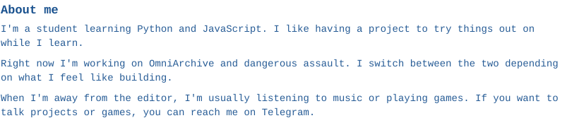

<table width="100%">
<tr>
<td colspan="2"><samp>$ miilxxwizi --info</samp></td>
</tr>
<tr>
<td align="center" valign="middle" width="420">

</td>
<td valign="top" width="420">
<!-- Edit the profile text in assets/terminal-info.svg. -->

</td>
</tr>
</table>

<picture>
  <source media="(max-width: 560px)" srcset="assets/about-me-mobile.svg" />
  
</picture>

  
  
  <a href="https://github.com/miilxxwizi?tab=repositories">Explore my repositories →</a>

