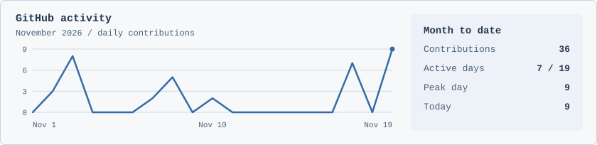

<table width="100%">
<tr>
<td colspan="2"><samp>$ miilxxwizi --info</samp></td>
</tr>
<tr>
<td align="center" valign="middle" width="420">
<a href="assets/ascii-transparent.gif?raw=1"></a>
</td>
<td valign="top" width="420">
<!-- Edit the text below directly. No GIF regeneration is needed. -->

```bash
"miilxxwizi@github
------------------------------------
Role:     Developer / Student
Learning: Python / JS
OS:       Windows
Shell:    PowerShell
Editor:   VS Code
Building: OmniArchive / dangerous assault
Hobbies:  sleeping, music, gaming
Goal:     Learn something every day

contacts
------------------------------------
GitHub:   github.com/miilxxwizi
Telegram: @miilxxwizizzzz
Email:    nurm.qp47@gmail.com"
```

</td>
</tr>
</table>

<h3><samp>About me</samp></h3>

<p><samp>I'm a student learning Python and JavaScript. I like having a project to try things out on while I learn.</samp></p>

<p><samp>Right now I'm working on OmniArchive and dangerous assault. I switch between the two depending on what I feel like building.</samp></p>

<p><samp>When I'm away from the editor, I'm usually listening to music or playing games. If you want to talk projects or games, you can reach me on Telegram.</samp></p>



<p align="center">
  <a href="https://t.me/miilxxwizizzzz"><kbd>Telegram ↗</kbd></a>
  <a href="https://discord.com/"><kbd>Discord ↗</kbd></a>
  <a href="https://github.com/miilxxwizi?tab=repositories">Explore my repositories →</a>
</p>
