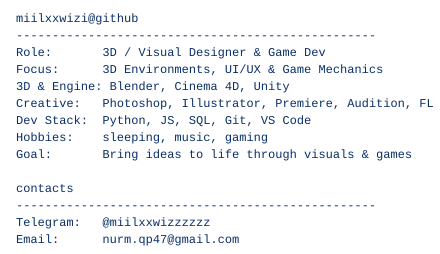

<table width="100%">
<tr>
<td colspan="2"><samp>$ miilxxwizi --info</samp></td>
</tr>
<tr>
<td align="center" valign="middle" width="420">

</td>
<td valign="top" width="440">

</td>
</tr>
</table>

### About me

I'm into visual design, 3D modeling, and game development. I like bringing ideas to life through interfaces, scenes, and interactive prototypes rather than sticking to just one narrow niche.

Right now I'm mostly focused on 3D environments, UI/UX concepts, and experimenting with game mechanics. I enjoy switching between modeling, visual editing, and engine work depending on what inspires me at the moment.

When I'm away from my workspace, I'm usually listening to music or playing games. If you want to talk design, 3D, or projects, you can reach me on Telegram.

### I aslo have ex:

**3D & Game Engines**

  

**Design & UI/UX**

  

**Video, Audio & Streaming**

   

**Dev & Tools**

     

 

  <a href="https://github.com/miilxxwizi?tab=repositories">Explore my repositories →</a>

