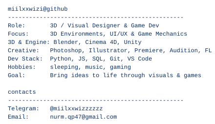

<table width="100%">
<tr>
<td colspan="2"><samp>$ miilxxwizi --info</samp></td>
</tr>
<tr>
<td align="center" valign="middle" width="420">

</td>
<td valign="top" width="440">

</td>
</tr>
</table>

### Обо мне

Я занимаюсь визуальным дизайном, 3D-моделированием и разработкой игр. Мне нравится воплощать идеи в интерфейсах, сценах и интерактивных прототипах и пробовать себя в разных направлениях.

Сейчас я в основном создаю 3D-окружения, прорабатываю концепции UI/UX и экспериментирую с игровыми механиками. Мне нравится переключаться между моделированием, визуальным редактированием и работой в игровом движке в зависимости от того, что меня в этот момент вдохновляет.

В свободное время я обычно слушаю музыку или играю. Если хочешь обсудить дизайн, 3D или проекты, пиши мне в Telegram.

### У меня также есть опыт

  <strong>3D и игровые движки</strong>&nbsp;
  
  
  

  <strong>Дизайн и UI/UX</strong>&nbsp;
  
  
  

  <strong>Видео, звук и стриминг</strong>&nbsp;
  
  
  
  

  <strong>Разработка и инструменты</strong>&nbsp;
  
  
  
  
  
  

  <a href="https://github.com/miilxxwizi?tab=repositories">Explore my repositories →</a>

 

